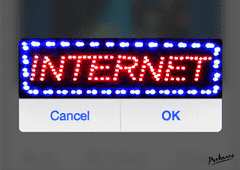
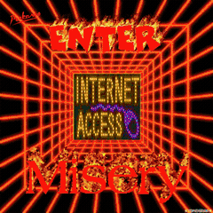
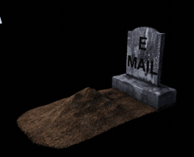
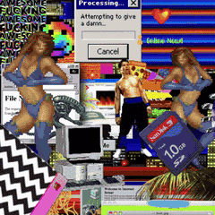
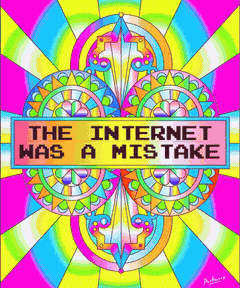
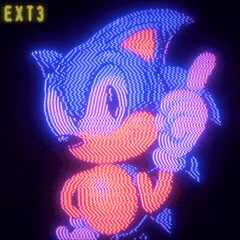
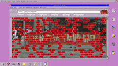
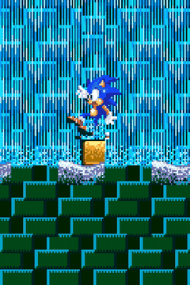
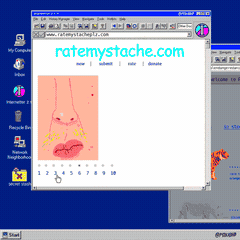
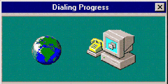

<h1>★ WELCOME TO BINZ120'S HOMEPAGE ★</h1>

<h3>🐧 ~ the 90s internet never died, it just moved to Linux ~ 🐧</h3>

<pre>
░▒▓█ ► ► ►  W E L C O M E  T O  M Y  H O M E P A G E  ◄ ◄ ◄ █▓▒░
</pre>

<b>HOME</b> · <b>GIF WALL</b> · <b>GUESTBOOK</b> · <b>WEB RING</b>

<b>NOW LOADING... PLEASE WAIT...</b>

Best viewed in Netscape Navigator 4.0 for Linux · 800×600 · Made with vi · Y2K compliant

---

> **Hi, I'm Binz120.** Security research, self hosted servers, and Linux every day. This page is my shrine to the dialup era: glitch art, dead email, dancing Sonic, and the beautiful chaos of the 90s web. No cookies. No tracking. No Web3. Just GIFs.

---

### 💾 MY 90s RIG

| SPEC | VALUE |
|---|---|
| CPU | Pentium II 350 MHz |
| RAM | 64 MB (upgraded!) |
| Modem | 56K US Robotics |
| OS | Slackware Linux 3.5 |
| Kernel | 2.0.36 |
| WM | AfterStep |
| Browser | Netscape Navigator 4.0 for Linux |
| Display | 800×600, 256 colors |

### 📼 NOW PLAYING

`♫ dialup.mid` on repeat

**AWAY MESSAGE:** brb, defragging

**AIM:** Binz120 · **ICQ:** 120120 · **Yahoo!:** binz120

---

### 🔎 WHAT I'M DIGGING INTO

- **Linux:** Omarchy and Hyprland every day; my servers run it too.
- **AI agents:** local model serving, agent harnesses, and the tooling that makes them useful on a desktop.
- **Offensive security and OSINT:** pentest automation, traffic and stream tooling, geolocation, recon.
- **Own hardware:** NVR, media, file sync, reverse proxies. If it can run on my own machine, it does.
- **Old games:** modding them. A massive PES fan; the older the football game, the more interesting it is to take apart.

### 📂 ABOUT THE FORK PILE

Most of my public repos are forks: things I read, patched, or ran to see how they work. That pile is a reading list, not a portfolio. The things I actually reach for live in my stars.

`Python` · `Go` · `Rust` · `TypeScript` · `Bash` · `Linux` · `Docker` · `Caddy` · `SQLite`

---

## ✨ THE GIF WALL ✨

*All twelve GIFs from the vault. Artist credits at the bottom.*

<table>
<tr>
<td align="center" valign="top">
 
<b>56K DREAMS</b> the sound of the internet
</td>
<td align="center" valign="top">
 
<b>INTERNET ACCESS MISHAP</b> PEEKASSO
</td>
<td align="center" valign="top">
 
<b>BILL AT THE KEYBOARD</b> 1996 energy
</td>
</tr>
<tr>
<td align="center" valign="top">
 
<b>THE INTERNET, 1997</b> haydiroket
</td>
<td align="center" valign="top">
 
<b>THE INTERNET WAS A MISTAKE</b> PEEKASSO
</td>
<td align="center" valign="top">
 
<b>SONIC GLITCHWAVE</b> Polygon1993
</td>
</tr>
<tr>
<td align="center" valign="top">
 
<b>INTERNET: OK / CANCEL</b> PEEKASSO
</td>
<td align="center" valign="top">
 
<b>THE FIREWALL GROWS FLOWERS</b> Marcie LaCerte
</td>
<td align="center" valign="top">
 
<b>DRUNK SONIC</b> Sabato Visconti
</td>
</tr>
<tr>
<td align="center" valign="top">
 
<b>RATEMYSTACHE.COM</b> Animation Domination High Def
</td>
<td align="center" valign="top">
 
<b>R.I.P. EMAIL</b> relive email
</td>
<td align="center" valign="top">
 
<b>DIALING PROGRESS</b> 56K forever
</td>
</tr>
</table>

---

## 📼 90s FAVORITES

| CARTOONS | GAMES | MUSIC | TECH |
|---|---|---|---|
| Sailor Moon, Dragon Ball Z, Rugrats, Pokémon, Digimon | Pokémon Red and Blue, Zelda: Ocarina of Time, Crash Bandicoot, Sonic, GoldenEye 007 | Nirvana, TLC, Backstreet Boys, Radiohead, Spice Girls | Slackware, Debian, Red Hat, SuSE, WindowMaker, AfterStep, X11, GCC, Apache, AIM, ICQ, GeoCities, Napster |

### MY TOP 8

1. Tux
2. Linus Torvalds
3. Sonic
4. The dialup tone
5. Slackware
6. A fresh pack of Pokémon cards
7. The Internet Archive
8. Anyone who signs the guestbook

---

## 📖 GUESTBOOK

You are visitor **#???**.

Email is dead, so sign the guestbook instead.

[✍️ SIGN THE GUESTBOOK](https://github.com/Binz120/binz120/issues/new) · [📚 READ THE ENTRIES](https://github.com/Binz120/binz120/issues)

---

## 🔗 WEB RING

| ◀ PREV | 🏠 HOME | NEXT ▶ |
|:--:|:--:|:--:|
| [Neocities](https://neocities.org) | [Cameron's World](https://www.cameronsworld.net/) | [The Useless Web](https://theuselessweb.com/) |

**More cool links:**

- [Internet Archive](https://web.archive.org/)
- [Space Jam 1996](https://www.spacejam.com/1996/)
- [GIPHY](https://giphy.com)

---

## 🚧 UNDER CONSTRUCTION 🚧

This shrine is always under construction. Check back after the dialup finishes.

---

## 💾 CREDITS

GIFs by **Polygon1993**, **Sabato Visconti**, **PEEKASSO**, **haydiroket**, **Animation Domination High Def**, and **Marcie LaCerte**. Sourced from GIPHY. All GIFs belong to their creators.

Page made with Notepad, caffeine, and a 56K modem. No cookies. No JavaScript. No Web3.

© 1998 to 2026 Binz120 · Last updated 11.09.2026 · This page is Y2K compliant · Best viewed at 800×600

