<div align="center">

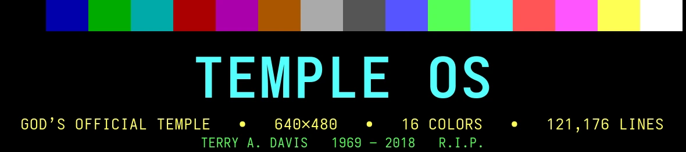

<br>

<h1>🕊️ A SHRINE TO TERRY A. DAVIS 🕊️</h1>

<h3>1969 &mdash; 2018</h3>

<pre>
 ▄▄▄▄▄▄▄▄▄▄▄▄▄▄▄▄▄▄▄▄▄▄▄▄▄▄▄▄▄▄▄▄▄▄▄▄▄▄▄▄▄▄▄▄▄▄▄▄▄▄▄▄▄▄▄▄▄▄▄
 █  ONE MAN. 121,176 LINES OF C. 640x480. SIXTEEN COLOURS.  █
 ▄▄▄▄▄▄▄▄▄▄▄▄▄▄▄▄▄▄▄▄▄▄▄▄▄▄▄▄▄▄▄▄▄▄▄▄▄▄▄▄▄▄▄▄▄▄▄▄▄▄▄▄▄▄▄▄▄▄▄
</pre>

<p><b>HOME</b> · <b>THE GIF WALL</b> · <b>THE PALETTE</b> · <b>HOLYC</b> · <b>THE RECORD</b> · <b>LINKS</b></p>

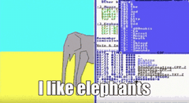

</div>

---

> **Terry Andrew Davis** wrote an operating system, the language it is written in, its compiler, its shell, its editor, its graphics stack and its games &mdash; alone, over roughly a decade, for a machine with **640&times;480 pixels and sixteen colours**.
>
> He called it **TempleOS**. He said God told him to build it.

This page is a shrine: the GIFs, the palette, the compiler, and the numbers. It is here because the work is genuinely remarkable and because the man who made it spent most of his life alone with it.

---

## 🖥️ WHAT HE ACTUALLY BUILT

| | |
|---|---|
| **Name** | TempleOS (formerly LoseThos, formerly SparrowOS) |
| **Author** | Terry A. Davis &mdash; sole developer, "Trivial Solutions", Las Vegas |
| **Language** | HolyC &mdash; a C dialect with JIT compilation, written by Davis |
| **Size** | ~121,176 lines of code, comparable to Photoshop 1.0 |
| **Display** | 640&times;480, 16 colours, fixed. A deliberate constraint, not a limitation |
| **Audio** | One voice |
| **Licence** | Public domain |
| **Ring** | Everything runs in ring 0. No userspace, no drivers-as-afterthought |
| **Filesystem** | RedSea, its own, with a Bible-derived naming scheme |
| **Docs** | Written into the OS itself: every symbol has a live, editable help page |

The charter, in his words: *"God's official temple. Just like Solomon's temple, this is a community focal point where offerings are made and God's oracle is consulted."*

He was asked why 640&times;480 and 16 colours. His answer: God told him it **"is a covenant like circumcision"** &mdash; small enough that a child could draw for God in it.

---

## 🌌 THE GIF WALL

<sub>Twenty GIFs, all of Terry. Sources and credits at the bottom.</sub>

<table width="100%">
<tr>
<td align="center" width="33%">
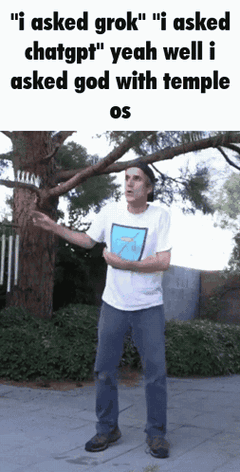<br>
<sub><b>I ASKED GOD</b><br>"I asked Grok. I asked ChatGPT."<br>"Yeah, well, I asked God."</sub>
</td>
<td align="center" width="33%">
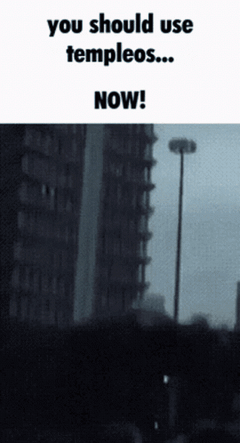<br>
<sub><b>YOU SHOULD USE TEMPLEOS</b><br>...NOW</sub>
</td>
<td align="center" width="33%">
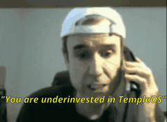<br>
<sub><b>UNDERINVESTED</b><br>a portfolio of one asset</sub>
</td>
</tr>
<tr>
<td align="center">
<br>
<sub><b>THE TEMPLE ITSELF</b><br>640x480 · sixteen colours</sub>
</td>
<td align="center">
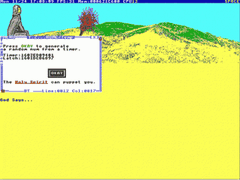<br>
<sub><b>THE HOLY SPIRIT</b><br>can puppet you in a game</sub>
</td>
<td align="center">
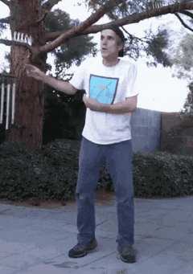<br>
<sub><b>WOBBLE</b><br>no further comment</sub>
</td>
</tr>
<tr>
<td align="center">
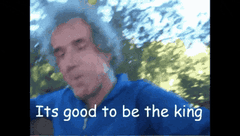<br>
<sub><b>IT'S GOOD TO BE THE KING</b><br>then the third panel</sub>
</td>
<td align="center">
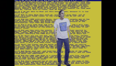<br>
<sub><b>TERRY DANCE</b><br>datamoshed into the grid</sub>
</td>
<td align="center">
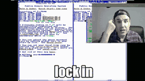<br>
<sub><b>LOCK IN</b><br>ten years, full time, one task</sub>
</td>
</tr>
<tr>
<td align="center">
<br>
<sub><b>ON THE TELEPHONE</b><br>he made a lot of calls</sub>
</td>
<td align="center">
<br>
<sub><b>NICE GUY</b><br>"you're a nice guy. a really nice guy."</sub>
</td>
<td align="center">
<br>
<sub><b>THE CAR PHONE</b><br>broadcasting from somewhere</sub>
</td>
</tr>
<tr>
<td align="center">
<br>
<sub><b>HANDS ON HEAD</b><br>the weight of the temple</sub>
</td>
<td align="center">
<br>
<sub><b>CLOSE-UP, GLITCHED</b><br>compressed until he's a signal</sub>
</td>
<td align="center">
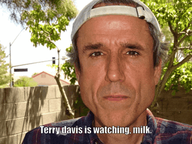<br>
<sub><b>HE IS WATCHING</b><br>milk.</sub>
</td>
</tr>
<tr>
<td align="center">
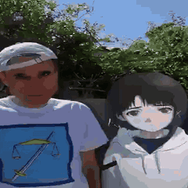<br>
<sub><b>STATIC PROPHET</b><br>the face he became online</sub>
</td>
<td align="center">
<br>
<sub><b>I LIKE ELEPHANTS</b><br>the 16-colour elephant</sub>
</td>
<td align="center">
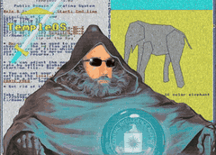<br>
<sub><b>THE ORB</b><br>TempleOS · CIA · elephant · all of it</sub>
</td>
</tr>
<tr>
<td align="center" colspan="3">
<br>
<sub><b>WE MISS YOU, TERRY</b></sub>
</td>
</tr>
</table>

---

## 🎨 THE SIXTEEN COLOURS

TempleOS ran in the standard VGA 16-colour palette. These are the actual values, and the whole aesthetic of the OS lives inside them.

| # | Colour | Hex | | # | Colour | Hex |
|---|---|---|---|---|---|---|
| 0 | Black | `#000000` | | 8 | Dark grey | `#555555` |
| 1 | Blue | `#0000AA` | | 9 | Light blue | `#5555FF` |
| 2 | Green | `#00AA00` | | 10 | Light green | `#55FF55` |
| 3 | Cyan | `#00AAAA` | | 11 | Light cyan | `#55FFFF` |
| 4 | Red | `#AA0000` | | 12 | Light red | `#FF5555` |
| 5 | Purple | `#AA00AA` | | 13 | Light purple | `#FF55FF` |
| 6 | Brown | `#AA5500` | | 14 | Yellow | `#FFFF55` |
| 7 | Light grey | `#AAAAAA` | | 15 | White | `#FFFFFF` |

Sixteen colours and no more. Every window, every icon, every game, every drawing in the temple was composed from that table.

---

## ⚙️ HOLYC

Not a scripting layer bolted onto C &mdash; a full language, with its own compiler, shipped **inside** the OS. It is JIT-compiled, it is untyped in the ways that annoy people, and it lets you recompile the operating system while you are using it.

```c
// Hello from the temple. Every symbol below has a live help page.
U0 HelloTerry()
{
  "TempleOS says hello.\n";
}

// 640x480, 16 colours, one voice. That is the covenant.
U0 Main()
{
  DocClear;
  "$$CYAN$$121,176 lines. One author.$$FG$$\n";
  "$$YELLOW$$640x480 x 16 colours.$$FG$$\n";
  HelloTerry;
}
```

The infamous detail that tells you what kind of programmer he was: he put the entire system in **ring 0**, with no userspace boundary at all. Not because he did not understand protection rings &mdash; because he did not need them. There was one user.

---

## 📜 THE RECORD

> "An idiot admires complexity, a genius admires simplicity."
>
> &mdash; Terry A. Davis

> "For ten years, I worked on programming TempleOS, full time. I finished, basically, and the last year has been tiny touch-ups here and there."
>
> &mdash; to Vice, *God's Lonely Programmer*

> "It's really obvious what to do next, and it can keep you busy for the first ten years."
>
> &mdash; same interview, on being told by God what to build

He was diagnosed with schizophrenia. He was homeless at points. He livestreamed for years to an audience that mostly came to watch the illness rather than the work, and he died in 2018 after being struck by a train.

The GIFs on this page are how the internet remembers him. The 121,176 lines are the part that should outlast them.

---

## 🔗 LINKS

| | |
|---|---|
| 📖 | [TempleOS archive](https://templeos.org/) &mdash; the OS, the docs, the ISO |
| 🗄️ | [templeos.org on the Wayback Machine](https://web.archive.org/web/2018*/templeos.org) |
| 📰 | [God's Lonely Programmer &mdash; Vice / Motherboard](https://www.vice.com/en/article/wnj43x/gods-lonely-programmer) |
| 💬 | [Terry A. Davis on Wikiquote](https://en.wikiquote.org/wiki/Terry_A._Davis) |
| 🎥 | [His own videos, archived](https://www.youtube.com/results?search_query=terry+a+davis+templeos) |
| 🧠 | [r/TempleOS](https://www.reddit.com/r/TempleOS/) |

---

## 💾 THIS PROFILE

The rest of the repos here are mine &mdash; security research, self-hosted servers, Omarchy themes, and a pile of forks I read for fun. This page is the shrine.

<div align="center">

<pre>
 ╔══════════════════════════════════════════════════════════╗
 ║  THE TEMPLE IS PUBLIC DOMAIN. THE WORK IS DONE.          ║
 ║  ONE MAN, ONE MACHINE, SIXTEEN COLOURS, TEN YEARS.        ║
 ╚══════════════════════════════════════════════════════════╝
</pre>


**R.I.P. TERRY A. DAVIS · 1969 &ndash; 2018**

<sub>640&times;480 &middot; 16 colours &middot; may his memory be compiled</sub>

</div>

---

<sub>**Credits:** GIFs sourced from Tenor, re-encoded for size, and belong to their original creators. TempleOS is public domain, released by Terry A. Davis / Trivial Solutions. Factual claims and quotations sourced from Vice's *God's Lonely Programmer* (2014) and Wikiquote. This is an unofficial fan shrine with no affiliation.</sub>
